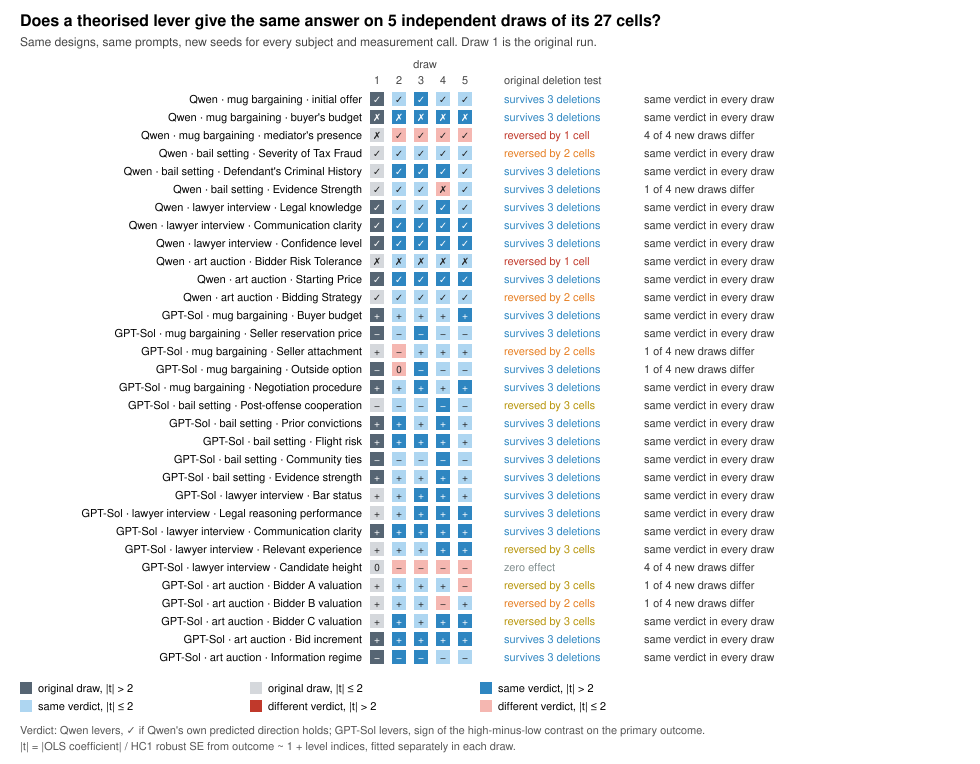

# Replicating automated science

**When a language model theorises the causes in a social-science experiment and then tests them on
simulated subjects, how much of the answer is the draw?**

Two kinds of tools now promise social science from language models: synthetic survey panels
(Expected Parrot) and a model that acts as both scientist and subjects (Manning, Zhu & Horton,
*Automated Social Science*, 2024). We replicated both with a small local model, Qwen3-8B, then
pushed them onto new problems to see where they break. Our conclusion: **the levers these agents
theorise, and whether those levers then "work", move with the stochastic draw.** Repeating every
draw with new seeds confirmed this for *which* levers get theorised and for whether an effect looks
statistically strong, and qualified it for the *direction* of an effect, which mostly repeats.

This repository contains everything from that project (October 2026, plus the repeated-seed runs of
November 2026):

- **all of the saved outputs**: every run, including the failed first attempts, with every raw
  model call, transcript, persona answer and measurement (nearly 8,500 model calls, 6,709 of them in
  the repeated-seed runs);
- **our results**, regenerated from those outputs by one script that needs no key, no model and no
  network;
- **our interpretation**, in [`my-takeaways.md`](my-takeaways.md), plus the original write-ups and
  slides;
- **the original code** for both projects, so you can rerun any part on your own Apple-silicon Mac.

## The headline result

In October we ran every experiment cell and every scientist design once, so our evidence for
instability was indirect: how many cells must be deleted before a lever's verdict reverses. In
November we reran the same code with new seeds, about four hours of model time: ten more scientist
designs per scenario, four more draws of all 216 experiment cells, and four more Expected Parrot
panels.

**Which levers get theorised is the most draw-dependent step.** Redrawing Qwen's design for the same
scenario with the same prompt gave 6 to 9 different lever sets in 11 draws per scenario. Only 5 of 40
new draws repeated the original design's three levers, and the mean Jaccard overlap between two
draws' lever names is 0.19 to 0.43, depending on the scenario. Some levers are near-certain
(communication clarity or skills in the interview, 11 of 11 draws); others appear once (the mug
study's "mediator's presence").



**Given a design, the direction of most levers repeats; their strength does not.**

| | Qwen designs, Qwen subjects | GPT-Sol designs, Qwen subjects |
|---|---:|---:|
| levers theorised | 12 | 20 |
| independent draws of each 27-cell study | 5 | 5 |
| same verdict in all five draws | 10 | 15 |
| \|coefficient / robust SE\| > 2 in all five draws | 4 | 2 |
| … in some draws but not others | 3 | 14 |
| … in no draw | 5 | 4 |
| deletion-fragile in the original (1–2 cells) and verdict changed in a new draw | 1 of 4 | 2 of 2 |
| survived 3 deletions and verdict changed in a new draw | 1 of 8 | 1 of 13 |

Qwen's own predictions held in 9, 10, 10, 9 and 10 of 12 levers across the five draws, so the
original "9 of 12" was a typical draw, not a lucky one. The big levers hold every time (prior
convictions raise bail, the seller's reservation price kills mug deals, communication clarity lifts
interview ratings). What moves is whether a lever clears |t| > 2: for 17 of the 32 levers that
depends on the draw. The deletion test was a rough guide: half of the six levers it flagged as
fragile kept their verdict in every new draw, and the one Qwen lever that did change (mediator
presence) turned out to have failed only in the original draw. In the auction, where auction theory
says the bidder valuations should matter most, two of GPT-Sol's three valuation levers changed sign
in one draw.

**In Expected Parrot, wording mattered more than the seed.** The same 12 personas changed 14 of 48
answers when the persona moved from the user prompt to the system prompt and the seed changed. With
the prompt held fixed, a new seed alone changes 4 to 7 of 48 answers on average; the prompt change
alone about 13.

One caution on all of this: at the subjects' temperature (0.3) many cells replay almost the same
conversation under a new seed (the same measured outcome in 31% to 87% of cell redraws, by study),
so "repeats across seeds" is a statement about this model's sampling, not proof that a lever is real.
What this does and does not show, the Expected Parrot polarisation result, and the runs that went
wrong are in **[my-takeaways.md](my-takeaways.md)**. The October deletion analysis is section 4 of
[`results/RESULTS.md`](results/RESULTS.md).

## Where to look

| if you want… | go to |
|---|---|
| our interpretation | [`my-takeaways.md`](my-takeaways.md) |
| every results table | [`results/RESULTS.md`](results/RESULTS.md) (CSV versions alongside) |
| what every output file holds | [`case-studies/DATA.md`](case-studies/DATA.md) |
| the original write-ups | `case-studies/automated-social-science/docs/runs/*.md`, `case-studies/expected-parrot/RESEARCH.md` and `experiments/expected_parrot_qwen_replication_report.md` |
| the slides | `case-studies/automated-social-science/docs/runs/*.png` and `.pdf`; `case-studies/expected-parrot/.artifacts/expected-parrot-one-slide/` |
| a simulated negotiation, hearing or auction | any `case-studies/automated-social-science/outputs/*/studies/*/cells.jsonl` (one cell per line, full transcript) |
| the exact prompt and raw reply of every call | `raw_calls.jsonl` (Automated Social Science); `manifest.json` + `responses.json` or `results.json` (Expected Parrot) |

## The two case studies

**Automated Social Science** (`case-studies/automated-social-science/`). Manning, Zhu & Horton give
a model four one-sentence scenarios (bargaining over a mug, setting bail for $50,000 tax fraud, a
lawyer job interview, a three-bidder art auction). The model proposes causes, treatments and an
outcome, simulated agents act out every treatment cell, and a measurement call reads the outcome
off the transcript. We never showed our models the paper's designs. In the first run Qwen did
everything: proposed one design per scenario (three causes × three levels), ran the 27-cell
factorial once per cell, and measured it. In the second run GPT Sol designed the studies (five
three-level factors each, run as a 27-cell orthogonal array) and Qwen only played the subjects and
measured. Subjects ran at temperature 0.3, measurement at 0.

**Expected Parrot** (`case-studies/expected-parrot/`). Expected Parrot's public "Lasagna Coke" study
had 12 synthetic personas in three segments rate a novelty soda on seven questions, and found sharp
polarisation. We rebuilt the pipeline locally (one self-contained prompt per persona, all answers
as one JSON object), ran it with Qwen, then swapped in Expected Parrot's own 12 personas and imitated
its separate-call elicitation to isolate what drives the polarisation. Personas answered at
temperature 0.7.

## Repository layout

```
my-takeaways.md             our interpretation
results/                    tables and figure, generated by analysis/make_results.py
analysis/make_results.py    builds results/ from the saved outputs (stdlib only)
tests/                      checks that the outputs reproduce the reported numbers
case-studies/
  DATA.md                   codebook for every output folder and file type
  run_repeated_seeds.py     reruns the original commands with new seeds (November 2026)
  automated-social-science/ original code (src/, tests/), designs/, schemas/, docs/runs/,
                            vendor/original_scm/ (upstream files, MIT), outputs/ (all runs)
  expected-parrot/          original code (parrot_baseline/, experiments/, tests/), RESEARCH.md,
                            .artifacts/ (all runs and the slide)
```

Each case study is the original project, copied with its own README, `pyproject.toml` and tests.
Run its commands from inside its folder.

## Reproduce our results (no key, no model)

Needs only Python 3.9 or newer; no packages.

```bash
python3 analysis/make_results.py      # rewrites results/ from case-studies/*/outputs and .artifacts
```

The output is deterministic. `make check` regenerates it and fails if anything differs from the
committed `results/`. `make test` (needs [`uv`](https://docs.astral.sh/uv/)) checks the headline
numbers against the saved outputs and the original write-ups, then runs both original test suites
(39 and 126 tests, all offline).

## Rerun the experiments (Apple silicon + MLX)

Nothing here calls a paid API and no code reads a key. All model calls go to
`mlx-community/Qwen3-8B-4bit` running locally through [MLX](https://github.com/ml-explore/mlx), so a
rerun needs an Apple-silicon Mac, about 5 GB of disk for the weights (downloaded from Hugging Face
on first use), and `mlx-lm`:

```bash
uv tool install mlx-lm==0.32.0        # provides mlx_lm.generate and a Python with mlx
```

Free, no model needed:

```bash
cd case-studies/automated-social-science
uv run assr-frontier validate                                     # checks the 108-cell design
uv run assr-replication smoke --output-dir outputs/my-mock-smoke   # scripted mock provider
uv run assr-frontier pilot --provider mock --output-dir outputs/my-mock-pilot

cd ../expected-parrot
python3 -m parrot_baseline.cli demo --output-dir .artifacts/my-demo   # rule-based demo engine
python3 -m parrot_baseline.web --port 8765                            # local web app, demo engine
```

The real runs, in the order we ran them (full flags are in each case study's README):

```bash
# Automated Social Science (from case-studies/automated-social-science)
uv run assr-replication generate-designs --output-dir outputs/canonical-designs-qwen3-8b \
  --model mlx-community/Qwen3-8B-4bit --max-tokens 2200 --base-seed 20261014
PYTHONPATH=src ~/.local/share/uv/tools/mlx-lm/bin/python -m assr_replication.generated_cli \
  --initial-dir outputs/canonical-designs-qwen3-8b/designs \
  --output-dir outputs/generated-experiments-qwen3-8b --model mlx-community/Qwen3-8B-4bit \
  --base-seed 2026101400                                                   # ~19 min
PYTHONPATH=src ~/.local/share/uv/tools/mlx-lm/bin/python -m assr_replication.frontier_cli \
  full-run --output-dir outputs/frontier-planned-qwen-subjects \
  --model mlx-community/Qwen3-8B-4bit --wall-clock-budget-seconds 3600      # ~40 min
uv run assr-frontier analyze --output-dir outputs/frontier-planned-qwen-subjects

# Expected Parrot (from case-studies/expected-parrot)
python3 -m parrot_baseline.cli run --engine mlx --output-dir .artifacts/my-mlx-12 --panel-size 12 \
  --seed 42 --concept-title "Lasagna Coke" --concept-description "<text from our manifest.json>"
~/.local/share/uv/tools/mlx-lm/bin/python experiments/expected_parrot_qwen_replication.py \
  --image <any image file> --output-dir .artifacts/my-qwen-replication

# The repeated-seed study (from the repository root; resumable, sequential, ~4 h on a Mac mini)
PARROT_IMAGE=<any image file> python3 case-studies/run_repeated_seeds.py pilot   # one draw per stage
PARROT_IMAGE=<any image file> python3 case-studies/run_repeated_seeds.py all --k 10 --s 4
```

`case-studies/run_repeated_seeds.py` only calls the commands above with new seeds and new output
directories (seeds and folder names are listed in [`case-studies/DATA.md`](case-studies/DATA.md)).
To hold the Qwen execution designs fixed it copies the original run's four `finalized.json` files
into each new run folder first, which the generated-experiment runner treats as already compiled.
Our new folders already exist, so it skips them; rename `DATE` in the script to make your own.

Things to know before rerunning:

- **Every runner refuses to overwrite** an existing output directory, so use new names; ours stay
  untouched. The frontier runner resumes an interrupted run in the same directory.
- **Same seeds give the same draws.** Our own reruns with the same seeds reproduced earlier outputs
  exactly; on other hardware or MLX versions they may not. Either way, a same-seed rerun confirms
  the pipeline, not the stability of any result. To see the variance,
  change `--base-seed` / `--seed`, as `run_repeated_seeds.py` does.
- **The GPT-Sol design bundle is an input**, `designs/frontier-planned-v1/designs.json`. It was
  written in a chat session, not by code, so there is nothing to rerun for that step. The runner's
  `--design-file` takes any bundle in the same format.
- **Swapping models.** The Automated Social Science code talks to models through a small
  provider-neutral protocol (`src/assr_replication/models.py`, `providers.py`): an MLX CLI provider,
  an in-process MLX provider and two mock providers. A hosted model needs a new provider class;
  if you write one, read its key from an environment variable, never from a file in the repo. The
  Expected Parrot code has a demo engine and an MLX engine (`parrot_baseline/engines.py`,
  `mlx_engine.py`).
- **The stimulus image is not included** (it shows third-party branding). The replication script
  only hashes the file you pass; the model never sees it, and receives the text transcription that
  is hard-coded in the script.

## What we changed from the original projects

The code is the original code. To make it run from this repository we made these edits and no
others:

1. `case-studies/expected-parrot/.gitignore`: removed `.artifacts/`, so the saved outputs are tracked.
2. `case-studies/automated-social-science/.gitignore`: removed `outputs/`, for the same reason.
3. `case-studies/automated-social-science/README.md`: the clone instructions pointed to the old
   private repository and branch; they now point here.
4. Saved outputs: in four Expected Parrot files the home-directory prefix of two executables was
   replaced by `~/` and the local image path by the bare file name (details in
   [`case-studies/DATA.md`](case-studies/DATA.md)). Nothing else in any output was edited.
5. Added `case-studies/expected-parrot/uv.lock`, generated by `uv` in the original folder but not
   committed there.

The repeated-seed study (November 2026) added files and changed no original code or output: the
driver `case-studies/run_repeated_seeds.py`, the new run folders it wrote (path-scrubbed the same
way as item 4), and new sections in `analysis/make_results.py`. The script's existing table functions
gained an optional run-folder argument so the same code reads every draw; their output for the
original runs is unchanged.

The Expected Parrot code comes from branch `feat/runnable-baseline` (which contains `main`); the
Automated Social Science code from branch `research/initial-runner` (which contains `main`).

## What is not included

Our private notes and session logs (replaced by `my-takeaways.md`); the old Git histories; build
artifacts (`dist/`), virtual environments and caches; the stimulus image; copies of papers; a Word
copy of a write-up whose Markdown version is included; and PowerPoint copies of two slides whose PDF
and PNG renders are included. Everything the analysis or the code reads is here.

## References

- Manning, B. S., Zhu, K., & Horton, J. J. (2024). *Automated Social Science: Language Models as
  Scientist and Subjects.* arXiv:2404.11794. The four scenario seeds and the comparison designs.
  The upstream structural causal models in `vendor/original_scm/` come from the authors' repository
  `KeHang-Zhu/lm-automated-social-science` (MIT), commit `c694c281`.
- Expected Parrot. EDSL, the open-source library behind its product
  ([github.com/expectedparrot/edsl](https://github.com/expectedparrot/edsl)), and the publicly shared
  "Lasagna Coke" Research Agent run whose personas and segment means we compare against. No Expected
  Parrot code is used here.

## License and citation

Code: MIT. Data and write-up: CC BY 4.0. The vendored upstream files keep their own MIT license.
See [`LICENSE`](LICENSE). If you use the code or data, please cite this repository (see
[`CITATION.cff`](CITATION.cff)).
