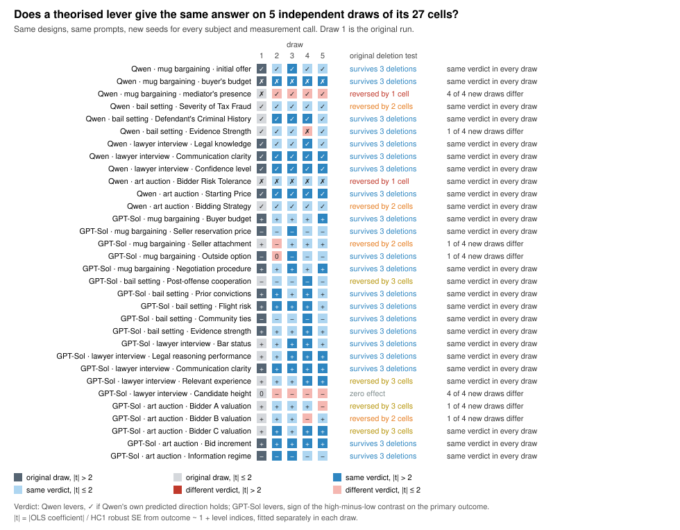
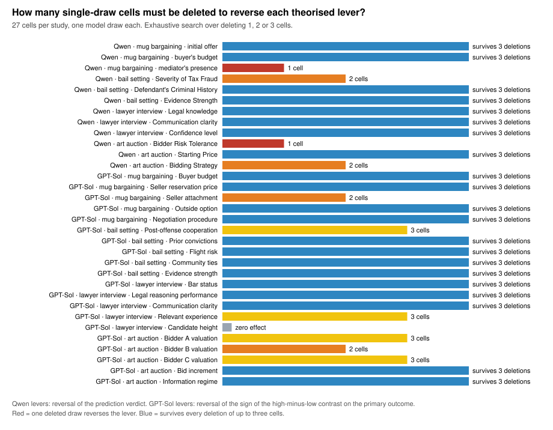

# Results

Generated by `python3 analysis/make_results.py` from the saved runs under `case-studies/`. Do not edit by hand. Nothing here is human data. Sections 1-3 compare repeated draws made with new seeds in November 2026; sections 4-11 describe the original October 2026 runs, in which every cell and every scientist design was drawn once.

## 1. Repeated subject draws: does each lever's verdict come back?

The original runs drew each experiment cell once. We reran every cell of both designs 4 more times with new seeds (same designs, prompts, temperatures and parsers), so each lever now has 5 independent estimates, each from its own 27 cells. A lever *differs* in a draw when its verdict is not the original one: for Qwen's levers, whether Qwen's predicted direction holds; for GPT-Sol's, the sign of the high-minus-low contrast. *Original deletion test* is the fragility class from section 4. *Pooled* applies the same verdict rule to the level means averaged over all draws, our best estimate of what this model does on average.

| | Qwen designs, Qwen subjects | GPT-Sol designs, Qwen subjects |
|---|---:|---:|
| levers theorised | 12 | 20 |
| independent draws of each 27-cell study | 5 | 5 |
| same verdict in every draw | 10 | 15 |
| verdict differs in at least one new draw | 2 | 5 |
| original verdict differs from the pooled verdict | 1 | 1 |
| deletion-fragile in the original (1-2 cells): levers | 4 | 2 |
| … of which differ in a new draw | 1 | 2 |
| reversed by 3 deletions in the original: levers | 0 | 4 |
| … of which differ in a new draw | 0 | 1 |
| survived 3 deletions in the original: levers | 8 | 13 |
| … of which differ in a new draw | 1 | 1 |
| \|t\| > 2 in every draw | 4 | 2 |
| \|t\| > 2 in some draws but not others | 3 | 14 |
| \|t\| > 2 in no draw | 5 | 4 |
| OLS coefficient has the same sign in every draw | 10 | 15 |
| single-draw verdicts matching the pooled verdict | 58 of 60 | 95 of 100 |

Qwen's predictions holding, by draw (original first): **9; 10; 10; 9; 10** (of 12).

Levers Qwen theorised (verdict = Qwen's predicted direction holds):

| study | lever | original deletion test | prediction holds in | new draws same as original | pooled: holds? | high − low by draw | \|t\| by draw |
|---|---|---|---:|---:|---|---|---|
| mug bargaining | initial offer | more than 3 | 5 of 5 | 4 of 4 | yes | 2.167; 0.7778; 1.589; 0.2222; 1.528 | 3.23; 0.93; 2.31; 0.25; 1.28 |
| mug bargaining | buyer's budget | more than 3 | 0 of 5 | 4 of 4 | no | 1.611; 2.167; 2.556; 1.694; 2.278 | 2.31; 2.46; 3.48; 3.77; 2.07 |
| mug bargaining | mediator's presence | 1 | 4 of 5 | 0 of 4 | yes | 0.5; -0.4444; 0.5889; 0.0278; 0.3056 | 0.73; 1.14; 1.61; 0.07; 0.57 |
| bail setting | Severity of Tax Fraud | 2 | 5 of 5 | 4 of 4 | yes | 55,556; 20,556; 30,556; 9,444; 58,333 | 1.27; 1.18; 1.61; 0.62; 1.29 |
| bail setting | Defendant's Criminal History | more than 3 | 5 of 5 | 4 of 4 | yes | 80,000; 63,333; 102,222; 41,111; 80,000 | 1.75; 2.98; 2.27; 2.92; 1.74 |
| bail setting | Evidence Strength | more than 3 | 4 of 5 | 3 of 4 | yes | 65,556; 36,111; 62,778; -2,778; 51,667 | 1.47; 1.59; 1.36; 0.19; 1.13 |
| lawyer interview | Legal knowledge | more than 3 | 5 of 5 | 4 of 4 | yes | 0.9921; 0.3889; 0.3333; 0.5; 0.3889 | 3.74; 1.34; 1.37; 2.99; 1.77 |
| lawyer interview | Communication clarity | more than 3 | 5 of 5 | 4 of 4 | yes | 1.238; 1.944; 1.667; 1.833; 1.444 | 5.72; 6.41; 7.47; 7.45; 6.63 |
| lawyer interview | Confidence level | more than 3 | 5 of 5 | 4 of 4 | yes | 1.882; 1.889; 1.722; 1.701; 2.222 | 9.9; 6.52; 7.34; 7.81; 10.5 |
| art auction | Bidder Risk Tolerance | 1 | 0 of 5 | 4 of 4 | no | -3.333; -7.778; -7.778; -7.778; -7.778 | 0.16; 0.4; 0.4; 0.37; 0.37 |
| art auction | Starting Price | more than 3 | 5 of 5 | 4 of 4 | yes | 83.33; 78.89; 81.11; 77.78; 84.44 | 3.3; 3.24; 3.38; 2.97; 3.34 |
| art auction | Bidding Strategy | 2 | 5 of 5 | 4 of 4 | yes | 8.889; 8.889; 6.667; 37.78; 3.333 | 0.65; 0.65; 0.49; 1.88; 0.18 |

Levers GPT-Sol theorised (verdict = sign of high − low on the primary outcome):

| study | lever | original deletion test | + / − / 0 draws | new draws same as original | pooled sign | high − low by draw | \|t\| by draw |
|---|---|---|---|---:|---:|---|---|
| mug bargaining | Buyer budget | more than 3 | 5 / 0 / 0 | 4 of 4 | + | 0.4444; 0.3333; 0.3333; 0.2222; 0.6667 | 2.68; 1.44; 1.98; 0.92; 4.26 |
| mug bargaining | Seller reservation price | more than 3 | 0 / 5 / 0 | 4 of 4 | − | -0.4444; -0.3333; -0.5556; -0.3333; -0.2222 | 3.26; 1.61; 4.1; 1.41; 1.2 |
| mug bargaining | Seller attachment | 2 | 4 / 1 / 0 | 3 of 4 | + | 0.1111; -0.1111; 0.1111; 0.1111; 0.1111 | 0.83; 0.44; 0.88; 0.43; 0.62 |
| mug bargaining | Outside option | more than 3 | 0 / 4 / 1 | 3 of 4 | − | -0.4444; 0; -0.4444; -0.1111; -0.1111 | 3.77; 0; 2.73; 0.48; 0.74 |
| mug bargaining | Negotiation procedure | more than 3 | 5 / 0 / 0 | 4 of 4 | + | 0.6667; 0.3333; 0.4444; 0.2222; 0.4444 | 4.02; 1.42; 2.14; 0.99; 2.12 |
| bail setting | Post-offense cooperation | 3 | 0 / 5 / 0 | 4 of 4 | − | -5,556; -1,111; -3,889; -10,000; -8,333 | 1.11; 0.28; 0.72; 2.16; 1.03 |
| bail setting | Prior convictions | more than 3 | 5 / 0 / 0 | 4 of 4 | + | 15,556; 15,000; 13,333; 11,111; 10,556 | 4.22; 3.59; 1.66; 2.33; 1.6 |
| bail setting | Flight risk | more than 3 | 5 / 0 / 0 | 4 of 4 | + | 13,611; 16,111; 21,111; 18,333; 13,333 | 2.66; 3.92; 2.51; 3.79; 1.75 |
| bail setting | Community ties | more than 3 | 0 / 5 / 0 | 4 of 4 | − | -11,667; -5,556; -10,000; -14,444; -13,333 | 2.35; 1.5; 1.28; 3.18; 1.92 |
| bail setting | Evidence strength | more than 3 | 5 / 0 / 0 | 4 of 4 | + | 12,222; 5,000; 12,222; 9,444; 13,333 | 2.33; 1.36; 1.62; 2.43; 1.56 |
| lawyer interview | Bar status | more than 3 | 5 / 0 / 0 | 4 of 4 | + | 17.78; 11.67; 17.43; 20; 8.889 | 1.79; 1.46; 2.26; 3.63; 1.33 |
| lawyer interview | Legal reasoning performance | more than 3 | 5 / 0 / 0 | 4 of 4 | + | 15.56; 8.333; 19.51; 23.33; 27.22 | 1.68; 1.11; 2.37; 4.2; 3.7 |
| lawyer interview | Communication clarity | more than 3 | 5 / 0 / 0 | 4 of 4 | + | 23.89; 31.67; 28.61; 29.44; 25 | 2.62; 4.28; 4.25; 5.97; 3.44 |
| lawyer interview | Relevant experience | 3 | 5 / 0 / 0 | 4 of 4 | + | 8.889; 4.444; 12.15; 15; 14.44 | 0.91; 0.57; 1.29; 2.61; 2.06 |
| lawyer interview | Candidate height | zero effect | 0 / 4 / 1 | 0 of 4 | − | 0; -12.78; -7.778; -10; -3.333 | 0; 1.68; 1.11; 1.68; 0.49 |
| art auction | Bidder A valuation | 3 | 4 / 1 / 0 | 3 of 4 | + | 43.33; 23.33; 8.333; 51.67; -29.44 | 0.97; 0.9; 0.23; 1.52; 1.02 |
| art auction | Bidder B valuation | 2 | 4 / 1 / 0 | 3 of 4 | + | 34.44; 12.78; 42.78; -5.556; 45.56 | 0.89; 0.66; 1.23; 0.2; 1.46 |
| art auction | Bidder C valuation | 3 | 5 / 0 / 0 | 4 of 4 | + | 37.22; 57.22; 3.889; 98.33; 62.22 | 0.92; 3.1; 0.11; 3.6; 2.31 |
| art auction | Bid increment | more than 3 | 5 / 0 / 0 | 4 of 4 | + | 115; 145.6; 148.9; 96.67; 96.67 | 2.6; 5.28; 4.16; 3.28; 3.56 |
| art auction | Information regime | more than 3 | 0 / 5 / 0 | 4 of 4 | − | -85; -45.56; -73.89; -41.67; -40.56 | 2.61; 2.73; 2.35; 1.65; 1.78 |

How much does a new seed change a cell at all? Each cell's new draws compared with its original draw (primary outcome as above; Qwen designs: the measured value):

| designs | study | cell × new-draw pairs | identical transcript | identical outcome |
|---|---|---:|---:|---:|
| Qwen designs | mug bargaining | 108 | 0 (0) | 38 (0.352) |
| Qwen designs | bail setting | 108 | 0 (0) | 90 (0.833) |
| Qwen designs | lawyer interview | 108 | 0 (0) | 64 (0.593) |
| Qwen designs | art auction | 108 | 65 (0.602) | 94 (0.87) |
| GPT-Sol designs | mug bargaining | 108 | 45 (0.417) | 85 (0.787) |
| GPT-Sol designs | bail setting | 108 | 0 (0) | 43 (0.398) |
| GPT-Sol designs | lawyer interview | 108 | 0 (0) | 56 (0.519) |
| GPT-Sol designs | art auction | 108 | 7 (0.065) | 33 (0.306) |

Per-draw statistics for every lever: `seed_repeat_levers_by_draw.csv`.

## 2. Repeated scientist draws: which levers does Qwen propose?

Qwen's design step reran 10 more times per scenario with new seeds (same prompt, temperature 0.3, up to three attempts for invalid output, as in the original), giving 11 draws including the original. *Names* compares lever names after lowercasing and collapsing whitespace; *concepts* applies a hand-coded map written after reading all the names (`QWEN_DRAW_CONCEPTS` in the script). Jaccard = |A ∩ B| / |A ∪ B| for two draws' lever sets, averaged over all pairs.

| scenario | draws | valid | invalid attempts | distinct sets (names) | most common set drawn | new draws repeating the original set | identical pairs (names) | mean Jaccard (names) | distinct sets (concepts) | identical pairs (concepts) | mean Jaccard (concepts) | distinct concepts | distinct outcome names | original levers redrawn |
|---|---:|---:|---:|---:|---:|---:|---:|---:|---:|---:|---:|---:|---:|---|
| mug bargaining | 11 | 11 | 0 | 6 | 4 times | 0 of 10 | 8 of 55 | 0.236 | 6 | 8 of 55 | 0.405 | 8 | 2 | buyer's budget / willingness to pay 8/10; mediator's presence 0/10; opening offer 3/10 |
| bail setting | 11 | 11 | 1 | 9 | 3 times | 2 of 10 | 3 of 55 | 0.242 | 7 | 6 of 55 | 0.415 | 8 | 1 | criminal history 9/10; evidence strength 3/10; offense severity 7/10 |
| lawyer interview | 11 | 11 | 3 | 6 | 4 times | 3 of 10 | 9 of 55 | 0.431 | 4 | 14 of 55 | 0.567 | 5 | 3 | communication 10/10; confidence level 7/10; legal knowledge 6/10 |
| art auction | 11 | 11 | 1 | 9 | 3 times | 0 of 10 | 3 of 55 | 0.189 | 9 | 3 of 55 | 0.307 | 9 | 2 | bidder risk tolerance 2/10; bidding strategy 7/10; starting price 6/10 |

Across the 12 levers of the original Qwen design, a new draw proposed the same concept 68 of 120 times; 5 of 40 new draws repeated the original lever set exactly. Levers drawn with both an *increase* and a *decrease* prediction: mug bargaining: buyer's budget / willingness to pay (decrease 3; increase 6); mug bargaining: opening offer (decrease 1; increase 3); art auction: bidder budget (decrease 1; increase 1).

How often each lever concept appears:

| scenario | concept | draws with it | in original draw | names used | predicted direction |
|---|---|---:|---|---|---|
| mug bargaining | buyer's budget / willingness to pay | 9 of 11 | yes | bob's maximum willingness to pay; buyer's budget; buyer's budget constraint; buyer's maximum willingness to pay | decrease 3; increase 6 |
| mug bargaining | mug's value / quality | 7 of 11 | no | mug quality; mug's perceived value; mug's true value | increase 7 |
| mug bargaining | seller's reservation price | 7 of 11 | no | alice's reservation price; seller's reservation price | increase 7 |
| mug bargaining | opening offer | 4 of 11 | yes | initial offer | decrease 1; increase 3 |
| mug bargaining | counteroffer | 2 of 11 | no | counteroffer | decrease 2 |
| mug bargaining | negotiation strategy | 2 of 11 | no | negotiation strategy | increase 2 |
| mug bargaining | initial price expectation | 1 of 11 | no | initial price expectation | increase 1 |
| mug bargaining | mediator's presence | 1 of 11 | yes | mediator's presence | non_monotonic 1 |
| bail setting | criminal history | 10 of 11 | yes | defendant's criminal history; prior criminal record | increase 10 |
| bail setting | offense severity | 8 of 11 | yes | severity of crime; severity of tax fraud | increase 8 |
| bail setting | defendant's finances | 4 of 11 | no | defendant's financial status; evidence of financial capability; evidence of financial stability | decrease 4 |
| bail setting | evidence strength | 4 of 11 | yes | evidence strength | increase 4 |
| bail setting | flight risk | 3 of 11 | no | defendant's flight risk; flight risk | increase 3 |
| bail setting | public safety | 2 of 11 | no | public safety; public safety concerns | increase 2 |
| bail setting | asset forfeiture | 1 of 11 | no | asset forfeiture | decrease 1 |
| bail setting | evidence of intent | 1 of 11 | no | evidence of intent | increase 1 |
| lawyer interview | communication | 11 of 11 | yes | communication clarity; communication skills | increase 11 |
| lawyer interview | confidence level | 8 of 11 | yes | confidence level | increase 8 |
| lawyer interview | legal knowledge | 7 of 11 | yes | legal knowledge | increase 7 |
| lawyer interview | legal experience | 4 of 11 | no | legal experience | increase 4 |
| lawyer interview | cultural fit | 3 of 11 | no | cultural fit | increase 3 |
| art auction | bidding strategy | 8 of 11 | yes | bidder b's aggressiveness; bidder strategy; bidding strategy | increase 8 |
| art auction | starting price | 7 of 11 | yes | starting price | increase 7 |
| art auction | bidder experience | 5 of 11 | no | bidder experience; previous auction experience | increase 5 |
| art auction | bidder confidence | 4 of 11 | no | bidder a's confidence; bidder confidence; bidder's confidence in art value | increase 4 |
| art auction | bidder risk tolerance | 3 of 11 | yes | bidder risk tolerance; bidder's risk tolerance | increase 3 |
| art auction | bidder budget | 2 of 11 | no | bidder c's budget limit; bidder's budget | decrease 1; increase 1 |
| art auction | market information | 2 of 11 | no | market demand signal; market observation | increase 2 |
| art auction | artistic preference | 1 of 11 | no | artistic preference | increase 1 |
| art auction | bidding history | 1 of 11 | no | bidding history | increase 1 |

Every draw's levers and outcome: `scientist_repeat_draws.csv`.

## 3. Expected Parrot: seed noise versus a prompt change

The replication script reran with new seeds and the three prompts unchanged. *Same prompt, different seed* compares one condition across every pair of seeds. *Prompt changed* compares two conditions across every combination of seeds; in the original single run this was the only comparison available, and it mixed the prompt change with a seed change. 48 ratings = 12 personas × 4 items. In the last three rows the columns count persona-items instead: how many of the 48 got the same rating from every seed, and how many spanned 2 or more points across seeds.

| comparison | pairs | ratings | identical (mean) | min | max | differ by ≥ 2 (mean) |
|---|---:|---:|---:|---:|---:|---:|
| same prompt, different seed: EP personas, one call, full context | 10 | 48 | 44.0 | 42 | 46 | 0.2 |
| same prompt, different seed: EP personas, separate calls, context only in Q1 | 10 | 48 | 43.6 | 41 | 45 | 0.4 |
| same prompt, different seed: EP personas as system prompt, separate calls, context only in Q1 | 10 | 48 | 40.6 | 39 | 43 | 0.4 |
| prompt changed, any seeds: persona in user prompt vs system prompt (separate calls) | 25 | 48 | 34.6 | 33 | 37 | 2.8 |
| prompt changed, any seeds: one call with full context vs separate calls | 25 | 48 | 22.0 | 18 | 25 | 10.6 |
| all 5 seeds give the same rating: EP personas, one call, full context |  | 48 | 41 |  |  | 1 |
| all 5 seeds give the same rating: EP personas, separate calls, context only in Q1 |  | 48 | 38 |  |  | 1 |
| all 5 seeds give the same rating: EP personas as system prompt, separate calls, context only in Q1 |  | 48 | 33 |  |  | 1 |

Segment means by seed (the original run is seed 42):

| seed | condition | appeal: adventurous / mainstream / health | appeal range | purchase: adventurous / mainstream / health | purchase range |
|---:|---|---|---:|---|---:|
| 42 | EP personas, one call, full context | 4 / 1.75 / 1.75 | 2.25 | 4 / 1.25 / 1 | 3 |
| 43 | EP personas, one call, full context | 4 / 1.75 / 1.75 | 2.25 | 4 / 1 / 1 | 3 |
| 44 | EP personas, one call, full context | 4 / 1.75 / 1.75 | 2.25 | 4 / 1.5 / 1 | 3 |
| 45 | EP personas, one call, full context | 4 / 1.75 / 1.75 | 2.25 | 4 / 1.5 / 1 | 3 |
| 46 | EP personas, one call, full context | 4.25 / 1.75 / 1.75 | 2.5 | 4.25 / 1 / 1 | 3.25 |
| 42 | EP personas, separate calls, context only in Q1 | 3.25 / 1.5 / 2 | 1.75 | 3.75 / 3.75 / 2 | 1.75 |
| 43 | EP personas, separate calls, context only in Q1 | 3.25 / 1.75 / 2 | 1.5 | 3.75 / 4.25 / 2 | 2.25 |
| 44 | EP personas, separate calls, context only in Q1 | 3.25 / 1.75 / 1.75 | 1.5 | 3.75 / 3.5 / 1.75 | 2.0 |
| 45 | EP personas, separate calls, context only in Q1 | 3.25 / 1.75 / 2 | 1.5 | 3.75 / 3.5 / 1.75 | 2.0 |
| 46 | EP personas, separate calls, context only in Q1 | 3 / 1.75 / 2 | 1.25 | 3.75 / 3.75 / 1.75 | 2.0 |
| 42 | EP personas as system prompt, separate calls, context only in Q1 | 3.5 / 1.75 / 1.25 | 2.25 | 3.75 / 3.25 / 2 | 1.75 |
| 43 | EP personas as system prompt, separate calls, context only in Q1 | 3.75 / 1.75 / 1.25 | 2.5 | 3.75 / 3 / 1.75 | 2.0 |
| 44 | EP personas as system prompt, separate calls, context only in Q1 | 3.5 / 1.75 / 1.5 | 2.0 | 3.75 / 3.25 / 2.25 | 1.5 |
| 45 | EP personas as system prompt, separate calls, context only in Q1 | 3.5 / 1.5 / 1.25 | 2.25 | 3.5 / 3 / 2.25 | 1.25 |
| 46 | EP personas as system prompt, separate calls, context only in Q1 | 3.5 / 1.75 / 1.25 | 2.25 | 3.75 / 3 / 2 | 1.75 |

## 4. How fragile is each theorised lever? (original single draws)

Each experiment cell was run once. *Cells to reverse* = the smallest number of the 27 cells whose deletion changes the lever's verdict (exhaustive search up to 3). For Qwen's levers the verdict is whether Qwen's own prediction holds; for GPT-Sol's levers it is the sign of the high-minus-low contrast (a change to exactly zero counts). `|t|` = |OLS coefficient| / HC1 robust SE from `outcome ~ 1 + level indices`.

| pipeline | levers | reversed by 1 cell | by 2 | by 3 | survive 3 deletions | zero effect | |t| < 2 |
|---|---:|---:|---:|---:|---:|---:|---:|
| Qwen scientist + Qwen subjects | 12 | 2 | 2 | 0 | 8 | 0 | 6 |
| GPT-Sol scientist + Qwen subjects | 20 | 0 | 2 | 4 | 13 | 1 | 9 |

## 5. Levers Qwen theorised, tested on Qwen's own subjects

| study | lever | Qwen predicted | low / mid / high mean | high − low | prediction holds | cells to reverse | OLS β | HC1 SE | \|t\| |
|---|---|---|---|---:|---|---:|---:|---:|---:|
| mug bargaining | initial offer | increase | 5.556 / 7.667 / 7.722 | 2.167 | yes | more than 3 | 1.083 | 0.3353 | 3.23 |
| mug bargaining | buyer's budget | decrease | 6.167 / 7 / 7.778 | 1.611 | no | more than 3 | 0.8056 | 0.3483 | 2.31 |
| mug bargaining | mediator's presence | non_monotonic | 6.667 / 7.111 / 7.167 | 0.5 | no | 1 | 0.25 | 0.341 | 0.73 |
| bail setting | Severity of Tax Fraud | increase | 50,000 / 50,000 / 105,556 | 55,556 | yes | 2 | 27,778 | 21,917 | 1.27 |
| bail setting | Defendant's Criminal History | increase | 36,667 / 52,222 / 116,667 | 80,000 | yes | more than 3 | 40,000 | 22,819 | 1.75 |
| bail setting | Evidence Strength | increase | 46,667 / 46,667 / 112,222 | 65,556 | yes | more than 3 | 32,778 | 22,235 | 1.47 |
| lawyer interview | Legal knowledge | increase | 7.222 / 7.389 / 8.214 | 0.9921 | yes | more than 3 | 0.3277 | 0.0877 | 3.74 |
| lawyer interview | Communication clarity | increase | 6.929 / 7.444 / 8.167 | 1.238 | yes | more than 3 | 0.6445 | 0.1127 | 5.72 |
| lawyer interview | Confidence level | increase | 6.562 / 7.562 / 8.444 | 1.882 | yes | more than 3 | 0.96 | 0.0969 | 9.9 |
| art auction | Bidder Risk Tolerance | increase | 160 / 143.3 / 156.7 | -3.333 | no | 1 | -1.667 | 10.3 | 0.16 |
| art auction | Starting Price | increase | 113.3 / 150 / 196.7 | 83.33 | yes | more than 3 | 41.67 | 12.64 | 3.3 |
| art auction | Bidding Strategy | increase | 131.1 / 188.9 / 140 | 8.889 | yes | 2 | 4.444 | 6.813 | 0.65 |

Predictions holding: **9 of 12**.

## 6. Levers GPT-Sol theorised, tested on Qwen subjects

Primary outcome per study as in the original regression slide (mug: deal 0/1; bail: $; interview: 0–100 rating; auction: final price $). Ordered coding of nominal factors (outside option, procedure, information regime) is a shorthand.

| study | lever | low / mid / high mean | OLS β | HC1 SE | \|t\| | cells to reverse sign |
|---|---|---|---:|---:|---:|---:|
| mug bargaining | Buyer budget | 0.2222 / 0.6667 / 0.6667 | 0.2222 | 0.08282 | 2.68 | more than 3 |
| mug bargaining | Seller reservation price | 0.7778 / 0.4444 / 0.3333 | -0.2222 | 0.06822 | 3.26 | more than 3 |
| mug bargaining | Seller attachment | 0.4444 / 0.5556 / 0.5556 | 0.05556 | 0.06659 | 0.83 | 2 |
| mug bargaining | Outside option | 0.7778 / 0.4444 / 0.3333 | -0.2222 | 0.05898 | 3.77 | more than 3 |
| mug bargaining | Negotiation procedure | 0.1111 / 0.6667 / 0.7778 | 0.3333 | 0.08282 | 4.02 | more than 3 |
| bail setting | Post-offense cooperation | 21,667 / 28,889 / 16,111 | -2,778 | 2,511 | 1.11 | 3 |
| bail setting | Prior convictions | 13,889 / 23,333 / 29,444 | 7,778 | 1,842 | 4.22 | more than 3 |
| bail setting | Flight risk | 17,500 / 18,056 / 31,111 | 6,806 | 2,557 | 2.66 | more than 3 |
| bail setting | Community ties | 30,000 / 18,333 / 18,333 | -5,833 | 2,481 | 2.35 | more than 3 |
| bail setting | Evidence strength | 16,111 / 22,222 / 28,333 | 6,111 | 2,621 | 2.33 | more than 3 |
| lawyer interview | Bar status | 60 / 79.44 / 77.78 | 8.889 | 4.974 | 1.79 | more than 3 |
| lawyer interview | Legal reasoning performance | 59.44 / 82.78 / 75 | 7.778 | 4.643 | 1.68 | more than 3 |
| lawyer interview | Communication clarity | 57.22 / 78.89 / 81.11 | 11.94 | 4.56 | 2.62 | more than 3 |
| lawyer interview | Relevant experience | 63.33 / 81.67 / 72.22 | 4.444 | 4.89 | 0.91 | 3 |
| lawyer interview | Candidate height | 74.44 / 68.33 / 74.44 | 0 | 4.782 | 0.0 | zero effect |
| art auction | Bidder A valuation | 145 / 182.2 / 188.3 | 21.67 | 22.34 | 0.97 | 3 |
| art auction | Bidder B valuation | 142.2 / 196.7 / 176.7 | 17.22 | 19.31 | 0.89 | 2 |
| art auction | Bidder C valuation | 161.1 / 156.1 / 198.3 | 18.61 | 20.28 | 0.92 | 3 |
| art auction | Bid increment | 126.7 / 147.2 / 241.7 | 57.5 | 22.13 | 2.6 | more than 3 |
| art auction | Information regime | 211.7 / 177.2 / 126.7 | -42.5 | 16.27 | 2.61 | more than 3 |

Descriptive statistics quoted in the frontier write-up:

| study | statistic | value |
|---|---|---:|
| mug bargaining | deal rate | 0.5185 |
| mug bargaining | mean price given a deal | 14.36 |
| bail setting | mean bail ($) | 22,222 |
| lawyer interview | hire rate | 0.6296 |
| lawyer interview | mean rating (0-100) | 72.41 |
| lawyer interview | cells needing the recovery call | 1 |
| art auction | mean final price ($) | 171.9 |
| art auction | mean allocative efficiency | 0.537 |
| art auction | share efficiently allocated | 0.4074 |
| art auction | no-sale cells | 10 |
| art auction | winners paying above their own valuation | 3 |

## 7. Same scenario, three scientists, different levers

Lever names are read from the data files. The overlap counts use a hand-coded concept map (`SHARED_CONCEPTS` in the script). GPT-Sol had seen summaries of the paper, so its overlap with Manning et al. is not independent.

| scenario | Manning et al. (GPT-4 + authors) | Qwen | GPT-Sol | levers | concepts named by all three | by exactly two |
|---|---|---|---|---:|---:|---:|
| mug bargaining | buyer's budget; seller's minimum acceptable price for the mug; seller's feelings of love towards the mug | initial offer; buyer's budget; mediator's presence | Buyer budget; Seller reservation price; Seller attachment; Outside option; Negotiation procedure | 11 | 1 | 2 |
| bail setting | Defendant's criminal history; Number of cases the Judge has already heard that day; Defendant's level of remorse | Severity of Tax Fraud; Defendant's Criminal History; Evidence Strength | Post-offense cooperation; Prior convictions; Flight risk; Community ties; Evidence strength | 11 | 1 | 1 |
| lawyer interview | whether the applicant passed the bar exam; the interviewer's level of friendliness; the job applicant's height | Legal knowledge; Communication clarity; Confidence level | Bar status; Legal reasoning performance; Communication clarity; Relevant experience; Candidate height | 11 | 0 | 4 |
| art auction | bidder 1's maximum budget for the piece of art; bidder 2's maximum budget for the piece of art; bidder 3's maximum budget for the piece of art | Bidder Risk Tolerance; Starting Price; Bidding Strategy | Bidder A valuation; Bidder B valuation; Bidder C valuation; Bid increment; Information regime | 11 | 0 | 1 |

## 8. Expected Parrot: segment means by elicitation

| condition | appeal: adventurous / mainstream / health | appeal range | purchase: adventurous / mainstream / health | purchase range |
|---|---|---:|---|---:|
| minimal personas, first prompt (anchored) | 3.0 / 3.0 / 3.0 | 0.0 | 3.0 / 3.0 / 3.0 | 0.0 |
| minimal personas, midpoint fix (original baseline) | 4.25 / 2.5 / 2.0 | 2.25 | 3.25 / 2.0 / 1.75 | 1.5 |
| EP personas, one call, full context | 4.0 / 1.75 / 1.75 | 2.25 | 4.0 / 1.25 / 1.0 | 3.0 |
| EP personas, separate calls, context only in Q1 | 3.25 / 1.5 / 2.0 | 1.75 | 3.75 / 3.75 / 2.0 | 1.75 |
| EP personas as system prompt, separate calls, context only in Q1 | 3.5 / 1.75 / 1.25 | 2.25 | 3.75 / 3.25 / 2.0 | 1.75 |
| public Expected Parrot run (cited, Claude + image) | 4.75 / 1.0 / 1.0 | 3.75 | 4.5 / 3.0 / 1.5 | 3.0 |

Overall means, separate-call condition vs the public run:

| measure | Qwen separate calls | Expected Parrot (cited) |
|---|---:|---:|
| overall_appeal | 2.25 | 2.25 |
| concept_clarity | 3.83 | 3.83 |
| uniqueness | 3.08 | 3.0 |
| purchase_intent | 3.17 | 3.0 |

## 9. Expected Parrot: does a persona give the same answer twice?

Same 12 personas and the same four 1–5 items. The first pair differs in where the persona sits (user vs system prompt, plus one line asking for a decisive answer) and in the seed; the second in whether all questions share one call with full context.

| comparison | ratings | identical | differ by ≥ 2 | personas crossing purchase ≥ 4 | who |
|---|---:|---:|---:|---:|---|
| separate calls: persona in user prompt vs system prompt | 48 | 34 | 2 | 1 | Karen |
| one call with full context vs separate calls | 48 | 22 | 11 | 3 | Priya; Karen; Tom |

## 10. Fixed seeds replay the same draw

| comparison | units | identical | total | note |
|---|---|---:|---:|---|
| pilot vs full run, frontier-mug-bargaining-01 | subject turns | 8 | 8 |  |
| pilot vs full run, frontier-lawyer-interview-01 | subject turns | 6 | 6 |  |
| pilot vs full run, frontier-art-auction-01 | subject turns | 8 | 8 |  |
| pilot vs full run, frontier-bail-setting-01 | subject turns | 0 | 8 | design for this study was edited between runs |
| Expected Parrot replication v1 vs v2, rich_personas_joint_full_context | persona raw outputs | 12 | 12 |  |
| Expected Parrot replication v1 vs v2, expected_parrot_like_separate_context_only_q1 | persona raw outputs | 12 | 12 |  |

## 11. Every saved run, including failures

Runtime is recorded model time (manifest or summed cell runtimes) where the run saved it.

| case study | run | what | units | succeeded | failed | model calls | minutes | note |
|---|---|---|---|---:|---:|---:|---:|---|
| automated-social-science | `canonical-designs-qwen3-8b-2026-10-14` | Qwen proposes one design per scenario | 4 scenarios | 4 | 0 | 4 |  | 4 of 4 designs valid on the first attempt |
| automated-social-science | `generated-experiments-qwen3-8b-2026-10-14` | Qwen-designed factorials run with Qwen subjects | 108 cells | 106 | 2 | 585 | 18.6 | 10 finalization calls rejected before 4 were accepted |
| automated-social-science | `frontier-pilot-2026-10-14-schema-v1-failed` | frontier pilot, measurement parser v1 | 4 cells | 0 | 4 | 42 | 2.3 | every interaction finished; all 4 measurements rejected by the v1 parser |
| automated-social-science | `frontier-pilot-2026-10-14` | frontier pilot after parser fix | 4 cells | 4 | 0 | 34 | 1.5 |  |
| automated-social-science | `frontier-planned-qwen-subjects-2026-10-14` | GPT-Sol-designed studies run with Qwen subjects | 108 cells | 107 | 1 | 920 | 40.2 | 1 interview measurement failed 3 times; recovered by a separate logged call |
| expected-parrot | `lasagna-cola-mlx-12` | first Qwen persona panel | 12 personas | 12 | 0 | 12 |  | 48 of 48 ratings at the midpoint 3 |
| expected-parrot | `lasagna-cola-mlx-12-unanchored` | same panel after the midpoint fix | 12 personas | 12 | 0 | 12 |  | 16 of 48 ratings at the midpoint 3 |
| expected-parrot | `expected-parrot-qwen-replication-v2` | EP personas under three elicitation conditions | 3 x 12 personas | 36 | 0 | 180 |  | v1 directory holds the first two conditions, identical answers |

The repeated-seed runs (November 2026; minutes from each run's `provenance.json`):

| stage | run | seed | units | succeeded | failed | model calls | minutes |
|---|---|---:|---|---:|---:|---:|---:|
| Qwen scientist designs | `scientist-design-repeats-qwen3-8b-2026-11-11/base-seed-20261114` | 20261114 | 4 scenarios | 4 | 0 | 4 | 1.4 |
| Qwen scientist designs | `scientist-design-repeats-qwen3-8b-2026-11-11/base-seed-20261214` | 20261214 | 4 scenarios | 4 | 0 | 4 | 1.3 |
| Qwen scientist designs | `scientist-design-repeats-qwen3-8b-2026-11-11/base-seed-20261314` | 20261314 | 4 scenarios | 4 | 0 | 4 | 1.4 |
| Qwen scientist designs | `scientist-design-repeats-qwen3-8b-2026-11-11/base-seed-20261414` | 20261414 | 4 scenarios | 4 | 0 | 4 | 1.4 |
| Qwen scientist designs | `scientist-design-repeats-qwen3-8b-2026-11-11/base-seed-20261514` | 20261514 | 4 scenarios | 4 | 0 | 5 | 1.8 |
| Qwen scientist designs | `scientist-design-repeats-qwen3-8b-2026-11-11/base-seed-20261614` | 20261614 | 4 scenarios | 4 | 0 | 7 | 2.5 |
| Qwen scientist designs | `scientist-design-repeats-qwen3-8b-2026-11-11/base-seed-20261714` | 20261714 | 4 scenarios | 4 | 0 | 5 | 1.7 |
| Qwen scientist designs | `scientist-design-repeats-qwen3-8b-2026-11-11/base-seed-20261814` | 20261814 | 4 scenarios | 4 | 0 | 4 | 1.4 |
| Qwen scientist designs | `scientist-design-repeats-qwen3-8b-2026-11-11/base-seed-20261914` | 20261914 | 4 scenarios | 4 | 0 | 4 | 1.4 |
| Qwen scientist designs | `scientist-design-repeats-qwen3-8b-2026-11-11/base-seed-20262014` | 20262014 | 4 scenarios | 4 | 0 | 4 | 1.4 |
| Qwen-designed cells | `generated-experiments-qwen3-8b-2026-11-11-seed-2036101400` | 2036101400 | 108 cells | 108 | 0 | 567 | 17.6 |
| Qwen-designed cells | `generated-experiments-qwen3-8b-2026-11-11-seed-2046101400` | 2046101400 | 108 cells | 108 | 0 | 567 | 17.6 |
| Qwen-designed cells | `generated-experiments-qwen3-8b-2026-11-11-seed-2056101400` | 2056101400 | 108 cells | 107 | 1 | 569 | 17.8 |
| Qwen-designed cells | `generated-experiments-qwen3-8b-2026-11-11-seed-2066101400` | 2066101400 | 108 cells | 108 | 0 | 567 | 17.0 |
| GPT-Sol-designed cells | `frontier-planned-qwen-subjects-2026-11-11-seed-2036101400` | 2036101400 | 108 cells | 108 | 0 | 918 | 35.1 |
| GPT-Sol-designed cells | `frontier-planned-qwen-subjects-2026-11-11-seed-2046101400` | 2046101400 | 108 cells | 107 | 1 | 920 | 35.4 |
| GPT-Sol-designed cells | `frontier-planned-qwen-subjects-2026-11-11-seed-2056101400` | 2056101400 | 108 cells | 108 | 0 | 918 | 35.5 |
| GPT-Sol-designed cells | `frontier-planned-qwen-subjects-2026-11-11-seed-2066101400` | 2066101400 | 108 cells | 108 | 0 | 918 | 35.7 |
| Expected Parrot panels | `expected-parrot-qwen-replication-2026-11-11-seed-43` | 43 | 3 x 12 personas | 36 | 0 | 180 | 2.4 |
| Expected Parrot panels | `expected-parrot-qwen-replication-2026-11-11-seed-44` | 44 | 3 x 12 personas | 36 | 0 | 180 | 2.4 |
| Expected Parrot panels | `expected-parrot-qwen-replication-2026-11-11-seed-45` | 45 | 3 x 12 personas | 36 | 0 | 180 | 2.4 |
| Expected Parrot panels | `expected-parrot-qwen-replication-2026-11-11-seed-46` | 46 | 3 x 12 personas | 36 | 0 | 180 | 2.4 |

Total recorded model time for the repeated-seed runs: 237 minutes (4.0 hours).
